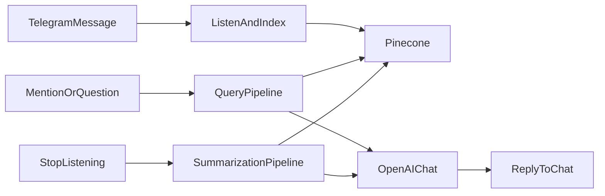

# ТЗ и план решения: VPg08. Кейс 4 — AI для команды

**Курс:** Профессия вайб-кодер  
**Модуль:** 8. Работа с памятью LLM  
**Урок:** [VPg08. Кейс 4: AI для команды](https://university.zerocoder.ru/pl/teach/control/lesson/view?id=345799344&editMode=0)

Документ фиксирует техническое задание командного Telegram-бота и пошаговый план реализации домашнего задания. Код бота в этот файл не входит — это спецификация для последующей разработки.

---

## 1. Цель

Собрать Telegram-бота для **группового рабочего чата**, который:

- слушает сообщения участников;
- сохраняет их в векторную базу **Pinecone** через пайплайны **Haystack**;
- резюмирует обсуждение (спор / решение);
- отвечает по контексту при подзыве или вопросе вроде «Что думаешь?».

Бот — помощник команды: помогает закрывать дискуссии, напоминает, кто что сказал, и выдаёт итог.

---

## 2. Контекст урока

Урок учит собирать AI-агента на пайплайнах Haystack, подключать Pinecone и OpenAI для анализа чатов и запускать готового Telegram-бота.

**Ориентир по времени:** чтение/просмотр ~40 минут, выполнение задания ~40 минут.

Опора — материалы предыдущего урока и туториал Haystack **Extractive QA** (пайплайны), скачанный как `.ipynb` и положенный в корень проекта как образец.

Обработка документов через Docling в этом кейсе **не обязательна**: в уроке прямо сказано, что бот на файлы не реагирует. Архитектура может это допустить позже, но в объём домашки это не входит.

---

## 3. Функциональные требования

### 3.1. Стек

| Слой | Технология |
|------|------------|
| Telegram | `pyTelegramBotAPI` (TeleBot) |
| Пайплайны | Haystack 2.x, актуальная документация 2025 |
| Векторное хранилище | Pinecone + интеграция Haystack |
| Эмбеддинги | OpenAI (`OpenAIDocumentEmbedder` / `OpenAITextEmbedder`) |
| Генерация текста | OpenAI (`OpenAIChatGenerator`) |
| Прокси LLM | обязательный `OPENAI_BASE_URL` (не прямой api.openai.com) |

Все эмбеддинги и вся генерация идут через OpenAI **с `base_url`**. В проекте уже задан `OPENAI_BASE_URL` в `.env` — его и использовать. Не подставлять устаревший URL из рассказа урока (`proxyapi.ru`), если в `.env` указан другой рабочий прокси.

Образец структуры пайплайна: файл `Pipeline example.ipynb` (туториал Extractive QA).

### 3.2. Поведение в чате

1. Бот добавляется в групповой чат с несколькими участниками.
2. Слушает **каждое** текстовое сообщение.
3. Пишет сообщение в Pinecone **вместе с метаданными автора** (id, имя/username, chat_id, timestamp, message_id).
4. Индексация идёт через пайплайн Haystack, не «вручную мимо пайплайна».

### 3.3. Команды listening

| Команда | Поведение |
|---------|-----------|
| `/start_listening` | Начать активную запись контекста в рамках сессии чата. Все сообщения до стопа копятся как диалог listening-сессии и параллельно уходят в векторную базу. |
| `/stop_listening` | Закончить сессию. Весь накопленный диалог уходит в LLM (пайплайн суммаризации), сохраняется в векторах, бот отвечает резюме в чат. |

Правила резюме на `/stop_listening`:

- если это **спор** — краткие тезисы сторон и **своё мнение** бота;
- если это **решение / выбор действий** — итог и финальная рекомендация;
- иначе — нейтральное саммари темы, ключевых тезисов и предложения, как продолжить обсуждение.

Если `/stop_listening` вызван без активной сессии — короткое сообщение об ошибке, без вызова LLM.

### 3.4. Подзыв и вопрос по контексту

Бот отвечает, если его **упомянули** (`@bot`) или задали вопрос по смыслу обсуждения, в том числе «Что думаешь?».

Ответ строится так:

1. взять последние сообщения и/или запрос пользователя;
2. найти релевантный контекст в Pinecone;
3. собрать внутреннее саммари;
4. сгенерировать ответ с отсылками вида: *тогда-то такой-то сказал вот это*;
5. вернуть текст в чат.

Не отвечать на каждое обычное сообщение вне listening-сессии и вне подзыва/вопроса — иначе чат заспамится. Обычные сообщения только индексируются.

### 3.5. Вне скоупа домашки

- Загрузка и анализ документов (Docling, PDF, договоры).
- Фоновый разбор параграфов файла.
- Web-интерфейс, админка, авторизация пользователей.
- Голосовые сообщения, стикеры, реакции — достаточно текста.

---

## 4. Нефункциональные требования

- Точка входа: `python bot.py`.
- Зависимости: `requirements.txt`, установка `pip install -r .\requirements.txt`.
- Логирование: старт пайплайнов, индексация, retrieval, вызов LLM, ошибки с трассировкой.
- Компоненты Haystack **нельзя переиспользовать** между пайплайнами: на каждый пайплайн — **новые экземпляры** embedder/retriever/generator. Иначе Haystack падает с ошибкой «component already used in another pipeline».
- Секреты только в `.env`, файл не коммитить.
- Индекс Pinecone и размерность эмбеддингов должны совпадать (в текущем `.env` задано `OPENAI_EMBEDDING_DIMENSIONS=512`).
- Namespace Pinecone — по чату или общий из `.env` (`PINECONE_MEMORY_NAMESPACE`), чтобы запросы не смешивали чужие диалоги без необходимости.

---

## 5. Архитектура



### 5.1. Слои

1. **`bot.py`** — Telegram: хендлеры сообщений и команд, listening-состояние по `chat_id`.
2. **`pipelines.py` (`PipelineManager`)** — три независимых пайплайна Haystack.
3. **`config.py`** — чтение `.env`, алиасы имён переменных, клиентские настройки OpenAI/Pinecone.
4. **Pinecone** — долговременная память сообщений.
5. **OpenAI (через base_url)** — эмбеддинги и генерация.

### 5.2. Потоки

**Индексация сообщения**

1. Пришло текстовое сообщение.
2. Собирается `Document` Haystack: текст + meta (`user_id`, `username`, `chat_id`, `date`, `message_id`).
3. Запускается indexing pipeline → вектор в Pinecone.

**Вопрос / mention**

1. Определяется, что это подзыв или вопрос («Что думаешь?» и т.п.).
2. Query pipeline: текст → вектор → top-k документы из Pinecone.
3. Prompt builder + LLM → ответ в чат.

**Стоп listening**

1. Берётся буфер сообщений сессии (+ при необходимости retrieval по чату).
2. Summarization pipeline собирает промпт и вызывает LLM.
3. Резюме уходит в чат; диалог уже лежит в векторах за счёт индексации на лету.

---

## 6. Три пайплайна (`PipelineManager`)

Класс-менеджер создаёт пайплайны **один раз при старте**. Компоненты внутри каждого пайплайна — отдельные объекты.

### 6.1. Индексация — `_create_indexing_pipeline`

Назначение: превратить текст сообщения в embedding и записать в Pinecone.

- Компонент Embedder (документный OpenAI embedder с `api_base_url`).
- Запись в document store / Pinecone с метаданными.
- По разбору урока indexing-пайплайн в первую очередь считает векторы; запись в store должна быть явной и рабочей (сообщение реально находится последующим поиском).

Вход: документы (текст сообщения + meta).  
Выход: проиндексированные векторы в Pinecone.

### 6.2. Поиск — `query_pipeline`

Назначение: семантический поиск по чату.

Состав:

- `OpenAITextEmbedder` — текст запроса → вектор;
- `PineconeEmbeddingRetriever` — поиск по индексу, `return` найденных документов.

Связь: `embedder.embedding` → `retriever.query_embedding` через `pipeline.connect`.

Вход: строка запроса.  
Выход: список релевантных документов с метаданными авторов.

### 6.3. Саммаризация — `_create_summarization_pipeline`

Назначение: резюме переписки / мнение по спору / итог решения.

Состав:

- шаблон диалога;
- свои экземпляры `OpenAITextEmbedder` и `PineconeEmbeddingRetriever` (не те же, что в query);
- `ChatPromptBuilder`;
- `OpenAIChatGenerator`.

Логика:

1. текст → вектор;
2. запрос в базу;
3. документы → `prompt_builder`;
4. промпт → LLM;
5. модель возвращает резюме.

Mention/вопрос может идти тем же контуром: retrieval → prompt → generator, с системным промптом «отвечай по контексту, цитируй авторов».

---

## 7. Переменные окружения

Файл `.env` в корне **уже есть**. В коде читать его через `python-dotenv`.

Имена в уроке и в текущем файле **не совпадают один в один**. Нужны алиасы: если задан урокный ключ — брать его, иначе — уже существующий.

| Урок | Уже есть в `.env` | Назначение |
|------|-------------------|------------|
| `TELEGRAM_BOT_TOKEN` | `TELEGRAM_BOT_TOKEN` | Токен бота |
| `OPENAI_API_KEY` | `OPENAI_API_KEY` | Ключ LLM/эмбеддингов |
| `OPENAI_BASE_URL` | `OPENAI_BASE_URL` | Базовый URL прокси |
| `OPENAI_MODEL` | `OPENAI_CHAT_MODEL` | Чат-модель |
| `EMBEDDING_MODEL` | `OPENAI_EMBEDDING_MODEL` | Модель эмбеддингов |
| `PINECONE_API_KEY` | `PINECONE_API_KEY` | Ключ Pinecone |
| `PINECONE_INDEX_NAME` | `PINECONE_INDEX_NAME` | Имя индекса |
| — | `PINECONE_CLOUD` | Облако индекса |
| — | `PINECONE_REGION` | Регион индекса |
| — | `PINECONE_MEMORY_NAMESPACE` | Namespace памяти |
| — | `OPENAI_EMBEDDING_DIMENSIONS` | Размерность векторов (512) |
| — | `MEMORY_RETRIEVAL_TOP_K` | top-k поиска (по умолчанию 6) |
| — | `CHAT_SESSION_MAX_MESSAGES` | Лимит окна/буфера сессии |

Правила:

- не коммитить `.env`;
- не затирать рабочие значения ради «как в видео»;
- при расхождении имени модели эмбеддингов править код/`config.py` под `.env`, а не наоборот.

---

## 8. Структура проекта

```text
VPg08/
├── TZ.md                      # это ТЗ
├── Pipeline example.ipynb     # туториал Extractive QA (образец)
├── bot.py                     # точка входа Telegram-бота
├── pipelines.py               # PipelineManager, три пайплайна
├── config.py                  # .env, алиасы, настройки
├── requirements.txt
├── .env                       # секреты, не в git
└── .gitignore
```

Допустимы небольшие вспомогательные модули (`logging_setup.py`, `prompts.py`), если это упростит `bot.py`. Отдельный веб-сервер не нужен.

---

## 9. Промпты бота (логика)

Системный промпт помощника команды (смысл, не дословный копипаст урока):

- ты помощник рабочей команды в общем чате;
- опирайся только на найденный контекст и текущий диалог;
- указывай автора и суть реплики, не выдумывай факты;
- если контекста мало — так и скажи;
- при споре — тезисы сторон и своё мнение;
- при выборе действий — итог и рекомендация;
- язык ответа — язык чата (обычно русский).

Пользовательский шаблон суммаризации: хронологический диалог + найденные похожие сообщения из Pinecone.

---

## 10. План реализации

Порядок работ после утверждения этого ТЗ (сам код бота — следующий шаг, не содержимое данного файла).

### Шаг 1. Образец Haystack

1. Открыть туториалы Haystack по Pipeline.
2. Скачать **Extractive QA** в формате `.ipynb`.
3. Положить в корень как `Pipeline example.ipynb`.

### Шаг 2. Конфигурация

1. Оставить существующий `.env`.
2. В `config.py` прочитать ключи с алиасами из раздела 7.
3. Добавить `.gitignore`: `.env`, `__pycache__/`, `.venv/`, логи.

### Шаг 3. Пайплайны

1. Реализовать `PipelineManager`.
2. Три пайплайна с **раздельными** экземплярами компонентов.
3. Подключить OpenAI через `api_base_url` / эквивалент Haystack 2.x 2025.
4. Подключить Pinecone (индекс, namespace, размерность 512).
5. Включить логирование входов/выходов пайплайнов.

### Шаг 4. Telegram-бот

1. `bot.py` на pyTelegramBotAPI.
2. Индексация каждого текстового сообщения.
3. `/start_listening` и `/stop_listening` с буфером по `chat_id`.
4. Реакция на mention и на «Что думаешь?» (и близкие формулировки).
5. Ответы только в этих случаях + команды.

### Шаг 5. Зависимости и запуск

1. Собрать `requirements.txt`: `haystack-ai`, интеграция Pinecone для Haystack, `pyTelegramBotAPI`, `python-dotenv`, клиент OpenAI/Pinecone по актуальной доке.
2. `pip install -r .\requirements.txt`
3. `python bot.py`

### Шаг 6. Типовые ошибки из урока — сразу избегать

- Не шарить один компонент Haystack на несколько пайплайнов.
- Передавать `api_base_url` в компоненты OpenAI так, как требует текущая версия Haystack.
- Сверять имя embedding-модели с `.env`.
- При «кривом» каркасе не чинить слой за слоем бесконечно — проще пересобрать пайплайны.
- Логировать полный traceback.

### Шаг 7. Проверка в Telegram

1. Создать/открыть группу, добавить бота, выдать право читать сообщения.
2. Написать 2+ реплики с разных аккаунтов (или смоделировать диалог).
3. Спросить «Что думаешь?» — ответ должен опираться на тему чата.
4. `/start_listening` → короткий спор/обсуждение → `/stop_listening` → резюме с тезисами.

---

## 11. Критерии приёмки (домашнее задание)

Из урока:

1. Туториал Extractive QA лежит в корне проекта как образец.
2. Есть `.env` с ключами Telegram, OpenAI и Pinecone.
3. В коде есть три пайплайна: индексация, поиск, суммаризация.
4. Зависимости ставятся из `requirements.txt`, бот запускается командой `python bot.py`.
5. В Telegram после нескольких сообщений вопрос «Что думаешь?» даёт **осмысленный ответ по контексту**.

Дополнительно по этому ТЗ:

- `/start_listening` / `/stop_listening` работают и возвращают резюме сессии;
- mention бота даёт ответ с опорой на историю;
- сообщения пишутся в Pinecone с автором;
- секреты не попадают в git.

---


